<!--
  简约科技风 · 深色优先 · 数据卡片每日自动刷新（见 .github/workflows/readme-refresh.yml）
-->

  

  

  
  
  

  <a href="#stack">技术栈</a> · <a href="#projects">精选项目</a> · <a href="#engineering">技术能力</a> · <a href="#codebase">代码构成</a>

**全栈开发|LLM Agent|数据分析|机器学习|Python|NA开发**

## `01` 技术栈

  
   
  
   
  

| 方向        | 主要技术                                                                             | 落在哪个项目里                                   |
| :---------- | :----------------------------------------------------------------------------------- | :----------------------------------------------- |
| 编程语言    | `Python` · `TypeScript` · `Java` · `C/C++` · `Rust` · `SQL`         | 后端与脚本、前端与工具链、算法练习、Tauri 桌面壳 |
| 前端        | `React` · `Next.js` · `Tailwind CSS` · `Bootstrap` · `Vite`            | ClipPoems 的拼贴画布与作品画廊                   |
| 后端        | `FastAPI` · `Flask` · `Pydantic` · `Typer`                                | ClipPoems 语料与作品服务、AI Market Sim 的编排层 |
| 数据 / ML   | `PyTorch` · `scikit-learn` · `pandas` · `NumPy` · `Jupyter`            | MNIST CNN 训练、树模型实验、数据分析笔记         |
| 工程 / 交付 | `Docker` · `Git` · `GitHub Actions` · `pytest` · `Prisma` · `Linux` | 容器化部署、CI、86 项 API 测试、SQLite 数据层    |

## `02` 精选项目

| 项目                                                                                | 它做什么                                                                                  | 关键实现                                                                                                                       | 技术                                                                                                                                                                                                                                                                                                                                                                                                                                                                                                                                      |
| :---------------------------------------------------------------------------------- | :---------------------------------------------------------------------------------------- | :----------------------------------------------------------------------------------------------------------------------------- | :---------------------------------------------------------------------------------------------------------------------------------------------------------------------------------------------------------------------------------------------------------------------------------------------------------------------------------------------------------------------------------------------------------------------------------------------------------------------------------------------------------------------------------------- |
| **[ClipPoems](https://github.com/Evan5321/ClipPoems)**                         | 拼贴诗歌创作工具：把诗句、成语拆成文字碎片，在画布上拖拽拼成作品                          | 五类内置语料（117 首诗词、530 条成语）配三种浏览方式；撕裂纸片效果按碎片尺寸实时生成 clip-path；30 秒自动保存快照，导出 2x PNG |      |
| **[ai-market-sim-finance](https://github.com/Evan5321/ai-market-sim-finance)** | AI 驱动的市场模拟与财务分析：LLM 生成用户画像 → 模拟消费行为 → 产出指标、图表与商业建议 | 多厂商模型统一封装，带 Token 预算控制与无 Key 时的优雅降级；86 项 API 测试兜底                                                 |                                                                                                                        |
| **[MLLearningDatabase](https://github.com/Evan5321/MLLearningDatabase)**       | 机器学习练习库：从决策树、随机森林、线性回归到 PyTorch CNN 训练 MNIST                     | 数据集、训练评估脚本与可视化笔记放在同一仓里，实验可复现、结论有出处                                                           |                                                                                                   |
| **[Notes](https://github.com/Evan5321/Notes)**                                 | 个人学习笔记库：经济、数学、历史、英语，外加 C/C++、Java、MySQL、Maven 的代码示例         | 笔记与可运行示例同仓维护，LaTeX 直接编译成 PDF                                                                                 |                                                                                                                                   |
| **[QuizSys](https://github.com/Evan5321/QuizSys)**                             | 模块化的 Python 答题系统：配置、数据、答题、复习四个模块各自独立                          | 按职责切分模块，换数据源或加题型时不用动答题流程                                                                               |                                                                                                                                                                                                                                                                                                                                                                                                                                       |

> **正在构建** · **MapCreator**（尚未开源）— 本地优先的架空世界地图工具。Python + FastAPI + SQLite（FTS5）+ MapLibre GL JS + Terra Draw；先把契约、数据规范、21 条决策记录和验收标准写清楚，再逐任务实现。

## `03` 技术能力

  

<table>
  <tr>
    <td width="50%" valign="top">
      <b>▍全栈交付</b> 
      从 Next.js 前端、FastAPI/Flask 服务到 SQLite 数据层独立打通； 
      ClipPoems 用 monorepo + pnpm workspace 管理多包，AI Market Sim 以 86 项 API 测试兜底。
    </td>
    <td width="50%" valign="top">
      <b>▍LLM 应用工程</b> 
      统一封装 DeepSeek / SiliconFlow / OpenAI / Anthropic / Gemini，切换模型只改配置； 
      处理 prompt 缓存、并发批量、Token 预算监控，以及没有 Key 时的降级路径。
    </td>
  </tr>
  <tr>
    <td width="50%" valign="top">
      <b>▍数据与机器学习</b> 
      从决策树、随机森林、线性回归到 PyTorch CNN，走完「数据 → 训练 → 评估 → 推理」； 
      每次实验保留参数、指标与可视化结果，方便回头对比。
    </td>
    <td width="50%" valign="top">
      <b>▍工程化与自动化</b> 
      架构先行：决策记录、依赖登记、验收标准、测试分层； 
      用 GitHub Actions 每日刷新本页数据卡片，提交只改数据、不动逻辑。
    </td>
  </tr>
</table>

## `04` 代码构成

  

  
  
  

---

 <a href="https://github.com/Evan5321"><code>github.com/Evan5321</code></a>

