<!--
  简约科技风 · 深色优先 · 数据卡片每日自动刷新（见 .github/workflows/readme-refresh.yml）
-->

  

  

  
  
  

  <a href="#highlights">能力概览</a> · <a href="#projects">精选项目</a> · <a href="#stack">技术栈</a> · <a href="#codebase">代码构成</a>

**全栈开发 · LLM 应用 · Agent 编排 · 数据分析 · 机器学习**

- **与 LLM 协同**：需求先写 PRD，选型留理由与替代方案，任务拆到带验收标准再交给模型执行
- **Agent 授权与交付**：按任务最小授权，命令与目录走白名单，分阶段提交、逐阶段验收
- **LLM 流水线控制**：状态机管推进与回退，Provider 抽象统一五家厂商，提示词版本化管理
- **成本与可靠性**：批量并发且失败隔离，usage 记账控成本；Fake Provider 让 86 项测试无需真实 Key

## `01` 精选项目

| 项目 | 它做什么 | 我在其中解决的问题 | 技术 |
| :--- | :--- | :--- | :--- |
| **[ai-market-sim-finance](https://github.com/Evan5321/ai-market-sim-finance)** | AI 市场模拟与财务分析：LLM 生成用户画像 → 模拟消费行为 → 产出指标、图表与商业建议 | 把一条五步 LLM 流水线做成可控系统：状态机管流程、抽象层管厂商、版本化管提示词、usage 管成本、Fake Provider 管测试 |     |
| **[ClipPoems](https://github.com/Evan5321/ClipPoems)** | 拼贴诗歌创作工具：把诗句、成语拆成文字碎片，在画布上拖拽拼成作品 | 用 PRD + 选型对比 + 分阶段 TODO 驱动开发：五类语料（117 首诗词、530 条成语）配三种浏览方式；撕裂纸片按碎片尺寸实时生成 clip-path；30 秒自动保存快照 |      |
| **[MLLearningDatabase](https://github.com/Evan5321/MLLearningDatabase)** | 机器学习练习库：从决策树、随机森林、线性回归到 PyTorch CNN 训练 MNIST | 数据集、训练评估脚本与可视化笔记同仓维护，实验可复现、结论有出处 |     |
| **[Notes](https://github.com/Evan5321/Notes)** | 个人学习笔记库：经济、数学、历史、英语，外加 C/C++、Java、MySQL、Maven 的代码示例 | 笔记与可运行示例同仓维护，LaTeX 直接编译成 PDF |     |
| **[QuizSys](https://github.com/Evan5321/QuizSys)** | 模块化的 Python 答题系统：配置、数据、答题、复习四个模块各自独立 | 按职责切分模块，换数据源或加题型时不用动答题流程 |  |

> **正在构建** · **MapCreator**（尚未开源）— 本地优先的架空世界地图工具。Python + FastAPI + SQLite（FTS5）+ MapLibre GL JS + Terra Draw；先写契约、数据规范、21 条决策记录和验收标准，再逐任务实现。

## `02` 技术栈

  
   
  
   
  

| 方向 | 主要技术 | 落在哪个项目里 |
| :--- | :--- | :--- |
| LLM / Agent | Provider 抽象与工厂 · 提示词版本化 · 批量并发 · Token 记账 · Fake Provider 测试 | ai-market-sim-finance 的五步流水线 |
| 编程语言 | `Python` · `TypeScript` · `Java` · `C/C++` · `Rust` · `SQL` | 后端与脚本、前端与工具链、算法练习、Tauri 桌面壳 |
| 前端 | `React` · `Next.js` · `Tailwind CSS` · `Vite` · `Zustand` | ClipPoems 的拼贴画布与作品画廊 |
| 后端 | `FastAPI` · `Flask` · `Pydantic` · `Typer` | ClipPoems 语料与作品服务、AI Market Sim 的编排层 |
| 数据 / ML | `PyTorch` · `scikit-learn` · `pandas` · `NumPy` · `Jupyter` | MNIST CNN 训练、树模型实验、数据分析笔记 |
| 工程 / 交付 | `Docker` · `Git` · `GitHub Actions` · `pytest` · `Prisma` · `Linux` | 容器化部署、CI、86 项测试、SQLite 数据层 |

## `03` 代码构成

  

  

这些数字直接来自 GitHub API：公开仓库数、Star 数、提交数，以及按代码字节统计的语言构成。
私有仓库和本地项目不计入，所以它更像一份「公开可见的脚印」。

  
  
  

---

  本页两张卡片由 <code>readme_assets/generate_cards.py</code> 生成，GitHub Actions 每天自动更新。 
  如果你也在做有意思的东西，欢迎来聊聊 · <a href="https://github.com/Evan5321"><code>github.com/Evan5321</code></a>

